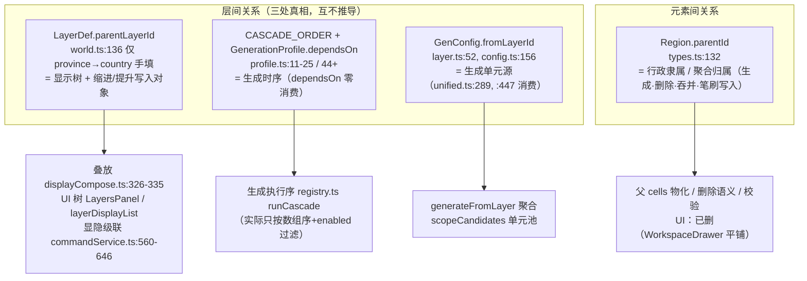

# Mapedi 全新父子图层 / 父子元素系统设计（层级系统重构）

> **定位**：设计稿——对应 2026-10-02 需求「好好分析一下现在的父子图层父子元素系统，从重新梳理需求出发，
> 考虑完整的重构一下相关的内容，设计一套全新父子图层父子元素系统」。
> **状态**：待拍板（§10 待拍板清单 D1–D8）。拍板后按 §8 分期实施，每期一个可独立验收的整包。
> **与 `GEN_UNIFIED_DESIGN.md` 的关系**：本文是其**超集**——生成引擎包（该稿 §6）被本文 §6 吸收，
> 且指针方向反转（见 §3.3）；该稿的拍板项 2/3 由本文 D1/D2 承接。
> **原话语义锚点**（2026-09-30 ~ 10-02，逐条对应）：
> ① 「图层不允许有多个子图层但允许多层子图层」
> ② 「有子图层的，首先生成子图层，然后以子图层元素为基本单元」（递归）；「无子图层以 cell 为单元」
> ③ 「没有子图层的元素其实就是默认的子图层叫地块图层」（默认 = cells）；「地块 = 重新撒点」「高度 = 赋高度」
> ④ 缩进 = 视觉上一行；提升 = 一次到顶层（2026-10-01 语义 v3）
> ⑤ 显隐唯一开关 = 眼睛；行点击只聚焦（2026-09-28）
> ⑥ 元素展开「子元素显示与子级创建先删（之后重新设计）」（2026-10-01）——**本设计 §6.4 即该重设计**
> ⑦ 叠放四条与父 cells ≡ ∪子（AGENTS §5 / §3，契约不动）

---

## 1. 现状分析：三条关系、两棵树、一片半死的 UI

### 1.1 现在到底存了什么



### 1.2 问题清单（P1–P10，均带证据）

| # | 问题 | 证据 | 后果 |
|---|------|------|------|
| P1 | **层间关系三处双真相**：显示树 / 生成时序 / 单元源各写各的，`dependsOn` 全库零消费、`registry.ts` 注释承诺的「dependsOn 过滤」根本没实现 | `profile.ts:11-25`、`layer.ts:52`、`world.ts:136`、`GEN_UNIFIED_DESIGN.md:11-18` 已点名 | 组织模式缩进只改显示，**生成完全不认**——层级的两半从未对话 |
| P2 | **元素树半死**：`parentId` 仍被生成/删除/吞并/笔刷/校验五路写入，但查看与编辑 UI 已于 2026-10-01 删除，拍板「之后重新设计」 | 写入方 `unified.ts:377`、`political.ts:103`、`brush.ts:80`、`history.ts:201,254`、`validate.ts:161`；UI 删除 `WorkspaceDrawer.svelte:111-133` | 数据活着、眼睛没了；层级只剩一半系统 |
| P3 | **无写入侧结构校验**：删层不清子层 `parentLayerId`（悬空），无环检查；靠读侧 `seen` 防环、16 跳上限、depth>8 截断、`validParent` 兜底 | `history.ts:417`、`displayCompose.ts:45,73,298-319`、`commandService.ts:234-235` | 护栏当修复（AGENTS §8 坑 2）；坏档静默进渲染 |
| P4 | **显隐继承只在写入期**：`isLayerShown` 不查父链，父隐子显只能靠 toggle 维护；且「关 = 写穿整棵子树」把子孙自身的 visible 抹掉 | `displayCompose.ts:251-263` vs `commandService.ts:628-640` | 旧档 / 绕过路径可产生父隐子显；父关再开，子孙原状态丢失 |
| P5 | **焦点叠放违反契约**：§5.3 是「焦点图层**整段**在非焦点之上」，实现只抬焦点自己——焦点为父层时会盖住自己的子层 | `displayCompose.ts:327-328`（`a === focus`） | 焦点 country 时 province 被压在焦点下面，与 §5.2「子>父」冲突 |
| P6 | **双路径漂移**：`regionOps` 的拖放/降级/升级/插入/删除五函数生产零调用（仅测试），生产走 `commandService`/`history` 另一套 | `regionOps.ts:46,126,167,256,321`；消费者仅 `tests/*.test.ts` | 两套语义各改各的必漂移（AGENTS §9.3 一处实现） |
| P7 | **id 编码父关系**：`${country.id}-p${i}`、`${childLayer.id}-${region.id}-auto` | `political.ts:101`、`brush.ts:79` | 潜在键反推拓扑（目前无人解析，属幸运）；重挂父后 id 不更新 |
| P8 | **数组三重身份**：兄弟序 + 叠放 listIndex + 「前序 DFS」推理前提混在一个 `world.layers` 数组里；兄弟按裸下标 swap 可打散前序 | `commandService.ts:369-375` | 目前消费端全部重推 DFS 所以未爆，属预存不变量松动 |
| P9 | **复制破坏链约束**：图层副本继承 `parentLayerId` → 可产生「一父二子」，而模型（含生成单元源）要求 ≤1 子 | `commandService.ts:423` | 拍板统一后这是生成语义歧义（units 来自哪个子层？），必须给策略 |
| P10 | **周边漂移**：缩进禁用态按过滤后列表算、落点按未过滤全表算；`OrganizeRow`/`LayersPanel` 注释仍是 v2「升一级」；organize 类型缺 `'organize'`（svelte-check 报错）；`opacity 缺省按树深度` 注释与实现（恒 0.88）不符；`defaultOpacityAtDepth` 等四个函数零消费 | `LayersPanel.svelte:149-154` vs `commandService.ts:269-275`、`OrganizeRow.svelte:5`、`App.svelte:459`、`types.ts:83`、`displayCompose.ts:98-161` | 契约表述与实现不一致，交接误读 |

### 1.3 一个正面发现：三棵树本来就是同一个概念

把三处现状摆在一起，同构关系一目了然（全部是已验证的代码事实）：

| 粒度 | 现在的表达 | 真实语义 |
|------|-----------|---------|
| 层 | `parentLayerId(province)=country` | 国家显示在行省之下（聚合者在下、组成部分在上） |
| 层（生成） | `fromLayerId(country)=province` | 国家的生成单元 = 行省元素（先生成行省再聚合） |
| 元素 | `province.parentId=country.id` | 国家元素 = ∪ 行省元素 |
| 绘制 | `resolveDrawTarget`：在国家上笔刷 → 实际画行省 | 父的归属由子物化，画父即画子 |
| 校验 | `orphan_province`：行省无父 → warn | 元素父必须跨到层父 |

用户的原话 ②「有子图层先生成子图层再以子图层元素为单元」**就是**这五行的统一表述。
所以问题从来不是「缺一个父子系统」，而是**同一个层级概念被拆成三处各写各的，其中两处互不相认**。

---

## 2. 需求重梳

### 2.1 必须保持的契约（用户原话 / AGENTS 硬规则）

| # | 契约 | 出处 |
|---|------|------|
| R1 | 层级 = **链**：每层至多一个子图层，但链可以任意长 | 原话 ① |
| R2 | 生成单元：`units(L) = 子图层元素`；无子图层 = cells；递归（先生成子再聚合） | 原话 ②③ |
| R3 | 两个特殊策略：cells = 重新撒点（破坏性）、height = 赋高度（+海陆删旧建新） | 原话 ③（用户定的特例，不是补丁） |
| R4 | 缩进 = 视觉上一行（位置零漂移）；提升 = 一次到顶层；上/下移 = 兄弟换位；单操作单命令 | 原话 ④（语义 v3） |
| R5 | 叠放四条：列表下层根→上层根 / 同树父→子 / **焦点整段**在上 / 选中元素最顶；无图层名特例 | AGENTS §5 |
| R6 | 显隐唯一开关 = 眼睛；行点击只聚焦不改显隐 | AGENTS §3 / §6 / 原话 ⑤ |
| R7 | 父 `Region.cells` ≡ ∪子（物化）；`Cell.polygon` / `Region.cells` 真相地位不动 | AGENTS §3 |
| R8 | 层级随档持久化，反序列化不许静默带坏结构 | AGENTS §4 序列化纪律 |
| R9 | 元素层级的 UI 需要回来（先删是暂存，不是废弃） | 原话 ⑥ |

### 2.2 由红线推导出的系统需求

- **S1 单源**：层关系只有一个真相；生成、显示、组织全部从它派生（AGENTS「同一概念只有一种核心定义」）。
- **S2 写入侧不变量**：悬空 / 成环 / 链违例 / 桥违例在**写入闸**被拒绝或修复，读侧护栏降级为防御而非代偿。
- **S3 读取侧单点**：children map、前序行、深度、子树、有效显隐——一处实现，全库引用（AGENTS §9.3）。
- **S4 删除策略表**：删元素 / 吞并 / 删层 / 撤销四种场景的「子怎么办」是一张表推出来的，不是四处各写。
- **S5 数组序只干一件事**：`world.layers` / `world.regions` 的数组序 = **兄弟序**；叠放、UI 行序全部由派生层换算（两种相反的「顶↔数组」映射封装在派生层内部）。
- **S6 id 不承载拓扑**：id 不再新增编码父关系的格式；全库禁止解析 id 推关系。
- **S7 一处实现**：生产入口唯一，`regionOps` 双路径清账。
- **S8 旧档安全**：读档时结构校验 + 确定性修复 + 报告，不静默、不崩溃。

---

## 3. 核心模型：一片层森林 + 一片元素森林

### 3.1 定义

```
世界
├─ 层森林   单源 = LayerDef.parentLayerId（child→parent 指针）
│            兄弟序 = world.layers 数组序（顶 = 数组首）
│            结构约束 = **链**（每层 ≤1 子层，R1）
│            派生：childLayer(L) = 以 L 为父的唯一层；无 → units(L) = cells
│
└─ 元素森林  单源 = Region.parentId（child→parent 指针）
             兄弟序 = (layerId, parentId) 相同者在 world.regions 中的数组序（顶 = 数组末）
             结构约束 = 一般树（一个父可多子）
             物化：父元素 cells ≡ ∪ 子元素 cells（R7）
```

**桥接不变量（两片森林的同构保证）**：

> **I-bridge**：若元素 `e` 有父 `p`，则 `layer(p) ≡ parentLayer(layer(e))`。
> 即元素的父边**恰好跨到层的父层**；层无父（根层）⇒ 该层元素不得有父。

这就是 §1.3 表格的形式化：元素森林是层森林在元素粒度上的投影，**不允许**出现与层树矛盾的元素边
（同层互挂、跨到子层都拒绝）。

### 3.2 不变量总表（写入闸 `core/hierarchy/gate` 强制）

| # | 不变量 | 违例处理 |
|---|--------|---------|
| I1 | 层父指针指向存在的层（或空） | 写入拒绝；读档修复→提升为根并报告 |
| I2 | 层森林无环；**每层 ≤1 子**（链） | 写入拒绝；读档修复（D6） |
| I3 | 元素父指针指向存在的元素（或空）；无环 | 写入拒绝；读档修复→清为未分配并报告 |
| I4 | 桥不变量（I-bridge） | 写入拒绝（error 级）；读档修复→清父并报告 |
| I5 | 父元素 cells ≡ ∪子（物化在**每次**父变更后的 `touchRegions` 里触发） | 既有管线（step7 已修 undo 后物化），回归点 |
| I6 | 有效显隐 `effective(L) = L.visible ∧ effective(parent)` | 读时派生，永不落盘、自愈旧档 |
| I7 | 生成 `units(L) = childLayer(L) ?? 'cells'`；生成序 = topo(单元边 ∪ 数据依赖边) | §6 |

读侧的 `seen` 防环 / 跳数上限在 I1–I4 落地后**降级为便宜防御**（旧档已被读档修复过，正常写入不可达），
不作为语义依赖——符合「护栏不能代替根因」。

### 3.3 为什么存 parent 指针而不是「单元源」指针（与 GEN 稿的关系）

GEN 稿的 `genParent(L)` = L 的单元源 = 本模型的 `childLayer(L)`——**同一份信息，指针方向相反**。
本设计选择保留 `parentLayerId`（child→parent）作为存储方向，理由：

1. 字段、序列化、缩进/提升、`displayAncestors`、校验修复全部现成，存储方向不变 = 旧档零迁移；
2. 组织手势（缩进 = 挂到上一行之下）天然写 parent 指针，写入路径最短；
3. 单元源是**派生量**：`units(L)` 用一张 children map（O(层数)，15~50 个）反查，生成一次级联建一次即可。

即：**不是「parentLayerId 从 genParent 投影」，而是「genParent 从 parentLayerId 派生」**——方向与 GEN 稿相反、
信息完全等价，GEN 稿 §4 的同构论证继续成立。`dependsOn` 中「environment→height」这类**数据依赖**
（需要高度值，与单元来源无关）按 GEN 稿 §4 的诚实边界**保留为独立关系**，不强行合并。

---

## 4. 派生层（读取侧唯一入口）`core/hierarchy/derive.ts`

纯函数 + `rev` 计数记忆化（AGENTS 热路径红线），全部消费方（compose / 面板 / 命令 / 校验）只准从这里取：

| 派生物 | 语义 | 现有对应物（收敛对象） |
|--------|------|----------------------|
| `childrenMap(kind)` | 父→子列表（数组序） | `layerDisplayList` 内联 walk、`LayersPanel` 内联 walk、`childrenOf`、`regionIndex.fillMap` |
| `rows(kind)` | 前序 DFS 平铺行 `{id, depth, parentId}`（UI 行序唯一来源） | `layerDisplayList`、`LayersPanel.walk` |
| `rootOf / depthOf / subtreeOf` | 沿父指针上爬 / 下探 | `displayCompose.rootOf/depthOf`（16 跳）、`displayTree`（depth>8 截断——**去截断**：写入闸已禁环，无界安全） |
| `effectiveVisible(layerId)` | I6 派生 | 无（新） |
| `siblingGroup(kind, node)` | 同 (父, 层) 兄弟数组 | `siblingRegions`、`moveItemStepImpl` 内联 filter |
| `stackOrderKey(focus)` | 叠放排序键（§6.1） | `composeShownPiecesUncached` 内联比较器 |
| `isAncestor(a, b)` | 祖先判定（防环 / 焦点段） | 散落的循环 |

**数组↔方向的两套映射封装在此**：层顶 = 数组首、元素顶 = 数组末（S5）——上/下移的方向差
只在 `siblingGroup` 内部换算一次，`organize` 不再写 `-1/+1` 分叉。

---

## 5. 操作与策略（写入侧唯一入口）`core/hierarchy/ops.ts` + `policy.ts`

### 5.1 结构操作（全部：纯计算 → 闸校验 → 写 → 一条命令 → 正确失效）

| 操作 | 语义（= 用户契约） | 约束与备注 |
|------|------------------|-----------|
| `indent(id)` | 成为**前序上一行**的子（位置零漂移，R4） | 前序上一行按构造必为叶子 → **链约束天然保持**；上一行是自己祖先的情况按构造不可达，闸仍断言 |
| `promote(id)` | `parent = undefined`，一次到顶层（R4） | 单命令 |
| `moveWithin(id, dir)` | 同父兄弟换位（数组 swap 只发生在同父组内） | 层：顶=数组首；元素：顶=数组末（方向在派生层内部换算） |
| `reparentElement(id, newParent)` | 元素换父（生成兜底 / 吞并 / 未来手动入口共用） | 闸校验 I-bridge；写后 `touchRegions` → 物化 |
| `copyLayer(id)` | **副本成为根**（D5，链安全） | 现状继承父 = P9 违例 |

层操作与元素操作共用闸与命令管线；元素**不做 indent/promote**——层内元素是反链
（父边总是跨到父层，§3.1），同层无嵌套可缩进，这是模型结论而不是 UI 偷懒（现 UI 已不渲染元素缩进钮，保持）。

### 5.2 删除策略表（policy.ts 单源，四种场景同构）

| 场景 | 子处理 | 现状对照 |
|------|--------|---------|
| 删元素 | 子 `parentId → undefined`（未分配），undo 经 `childParents` 快照恢复 | 保持 `history.ts:199-215` |
| 吞并 | 子改挂攻击方（闸复核桥不变量） | 保持 `history.ts:251-256` |
| **删层** | ① 该层元素随层删除；② **子层提升为被删层的父**（链拼接，不再留悬空 `parentLayerId`——修 P3）；③ 因①失去父的元素走「删元素」行 | ②是新规则（现状靠读侧兜底） |
| 撤销/重做 | 全量快照还原 + `materializeParentCells`（step7 已补） | 保持，列为回归点 |

### 5.3 读档修复（S8，`deserializeWorld` 收尾调用）

确定性修复 + 计数报告（status / console.warn 各一）：
悬空层父→根；层环→在最低深度处断开；一父二子→数组序保留首个、其余提升为根（D6）；
元素父缺失/桥违例→清为未分配。**不动 cells / 邻接**——只修层级指针。

---

## 6. 各子系统接线

### 6.1 显示（叠放 + 焦点）

排序键（`stackOrderKey`，替换 `displayCompose.ts:326-335` 内联比较器）：

```
1. inFocusSubtree(L) ? 1 : 0          // 焦点**整段**（焦点+全部后代）最后画 —— 修 P5，§5.3 字面语义
2. rootIdx(L) 降序                     // 非焦点组：列表上层根 → 后画
3. depth(L) 升序                       // 同树：父 → 子
4. 数组序稳定                          // 层内兄弟：数组后 = 画上
（regionSelected 最顶 —— 不动，RENDER_LOGIC.md:92）
```

焦点为深层子层时其祖先/旁支留在非焦点组（正确：契约说的是「整段」=子树，不是整棵树）；
链条无分叉，焦点子树 = 单链段，组内次序由键 2/3 完全决定。下游 GL/2D/球面零改动（仍按 pieces 序绘制）。

### 6.2 显隐（I6）

- **读**：`isLayerShown` 改为 `effective`（单点，所有消费方自动生效——compose、装饰层、球面、绘制红字守卫）；
  旧档「父隐子显」被读时派生**自愈**，不需要读档修复。
- **写**：开 = 自身 + 祖先链点亮（可达性，保持现状）+ 3 根树配额逻辑不动；
  **关 = 只写自身**（新，D8 见下）：子孙 effective 随之隐藏，但各自 `visible` 保留——
  父层再开时子孙回到原状态。现状「关=写穿子树」退役，`LayersVisibilityCommand` 快照域反而变小。
- 行点击只聚焦、眼睛唯一开关：不动（R6）。

### 6.3 生成（GEN 引擎包在此吸收）

- **单元源**：`units(L) = childLayer(L) ?? 'cells'` —— 替换 `GenConfig.fromLayerId` 三处
  （`layer.ts:52` / `config.ts:156` / `layer.ts:130` 的 params 覆盖），`unified.generateFromLayer`、
  `scopeCandidates` 的取数对象改为派生（`fromLayerCount` 等**聚合法参数**保留，它不是关系）。
- **生成序**：`CASCADE_ORDER` 数组删除；序 = 拓扑排序，边 = ①单元边 `L → child(L)`（L 等子层先完成）
  ②数据依赖边 `profile.dependsOn`（**剔除其中的单元源项**——country 的 `['province']` 由树表达，移除；
  province/environment 的 `['height']` 是真数据依赖，保留）。平级打破平手按现 CASCADE 相对序 →
  内置 13 层拓扑序与现状一致，**生成输出不变**。
- **registry 死字段复活**：`runCascade` 真正消费数据依赖过滤（注释承诺了半年的语义落地）。
- **递归 regen（R2）**：`regenLayer(L)` 先确保子层可用（无元素→递归生成），再生成 L；
  cells 重新撒点照旧级联全失效（R3 特殊策略，显式 switch，非补丁）。
- **profiles 迁移**：仅 `{layerId, params}` 落盘（`store.svelte.ts:100`），`dependsOn` 不持久化 → **零迁移**。
- **landsea**：保持根层（D2）。它的「随高度重建」是**数据依赖**（派生），不是单元源——
  挂到 height 下会让「单元边 = 等子层先完成」变成 height 等 landsea 的**环**，故不挂。

### 6.4 元素 UI（原话 ⑥ 的「之后重新设计」= 本节）

模型结论先行：**元素的父边总是跨层（I-bridge），层内元素不存在嵌套**——所以「列表按父子嵌套」
在数据上根本不成立（旧 kids 递归展示的是子图层的元素，这正是它被删时的错位感来源）。重设计：

1. **列表保持平铺**（现状）：一屏 = 焦点层的元素，兄弟序 = 叠放序（顶=数组末）。
2. **层级入口移到检查区**（展开行内）：
   - 「隶属」行：父元素名（父层元素），点击 = 聚焦父层 + 选中该父元素（C7 反解会滚动到位）；
   - 「子元素 N」行：子图层中 `parentId = 本元素` 的前若干个 + 「全部 N 个」，点击跳转逐个；
   - 均由派生层取数，无新真相。
3. **创建**：列表创建行仍建本层元素（初始未分配 → `orphan` warn 照旧）；
   手动挂靠入口 = 检查区「挂靠到…」（复用孤儿修复的共享 cell 最多算法）——是否**自动挂靠**见 D4。
4. **组织模式**：元素行保持 ↑↓ 两钮；缩进/提升钮不回归（理由同上）。
5. 绘制模式的笔刷自动建子（`brush.resolveDrawTarget`）不动——它是桥不变量的生产方之一。

### 6.5 命令与撤销

ops 全部为纯 core 计算，`commandService` 负责 `history.run`（既有 `LayerFieldsCommand` /
`LayersOrderCommand` / `RegionsOrderCommand` / `DeleteLayerCommand` 快照语义不变）+ status + `touch*` 失效；
一次结构操作 = 一条命令。元素父变更一律 `touchRegions`（物化 + autosave 触发）。

---

## 7. 与现状差异 / 清账清单

| 项 | 动作 |
|----|------|
| `regionOps` 死路径（`applyRegionDrop`/`demoteRegionAsChild`/`promoteRegionToParentLayer`/`insertRegionAfter`/`deleteRegionKeepChildren`） | 删函数；其测试表达的业务规则（兄弟序/缩进语义/桥校验）**迁到 ops 的测试面**，规则不改 |
| `CASCADE_ORDER`、`GenConfig.fromLayerId`、params 覆盖 | 删（§6.3） |
| `displayTree` depth>8 截断、`rootOf` 16 跳 | 去截断/去跳数（闸已禁环），保留 O(depth) 上爬 |
| `displayCompose.ts:98-161` 死函数（`defaultOpacityAtDepth` 等四件） | 删（步骤 7 大扫除同批） |
| `types.ts:83` 「缺省按树深度」注释 vs 实现恒 0.88 | 改注释为事实（或拍板实现——倾向改注释，透明度契约不在本设计范围） |
| id 编码父（`-p{i}`、`-auto`） | 新 id 改用不嵌父名的格式；存量不动（无解析方），S6 写进 AGENTS §4 |
| `OrganizeRow.svelte:5`、`LayersPanel.svelte:7` v2 注释；`App.svelte:459` organize 类型；右键菜单「长按拖动」陈旧注释 | 随包修正 |
| 过滤态缩进禁用态 vs 落点不同源 | 统一取 `rows()` 同一来源（D3） |
| `copyItem` 继承父（P9） | 副本成根 + status 说明（D5） |

---

## 8. 实施分期（每包独立验收，问题/原理/预期效果齐全）

| 包 | 内容 | 验收要点 |
|----|------|---------|
| **包1 层级内核** | `core/hierarchy/{derive,ops,policy,gate}.ts`；读档修复；删除策略表接线（DeleteLayer 补子层提升）；双路径清账；copy 链策略；测试面迁移 | tsc/svelte-check 0；浏览器：缩进/提升/上移/撤销回位、删自定义层→子层提升无悬空、旧档注入坏指针→修复+报告；反例清单 §9 过一遍 |
| **包2 显示包** | 焦点**整段**叠放；`effective` 显隐读派生；眼睛「关=只写自身」 | 像素验收：焦点 country→province 不再被压（A/B diff）；父关→子 effective 隐、父开→子原状态回；旧档父隐子显自愈 |
| **包3 生成包** | units=子层；拓扑序替换 CASCADE；递归 regen；`fromLayerId` 退役；registry 消费数据依赖 | 生成 100k 链路输出与现状**逐位对照**（拓扑平级序保持）；单层 regen 递归生成缺元素的子层；tsc 0 |
| **包4 元素 UI 包** | 检查区「隶属/子元素」跳转；挂靠入口；组织钮/注释/类型收口 | 跳转链路（选省→隶属跳国→焦点切 country）；创建→挂靠→撤销；svelte-check 0（organize 类型错误消除） |

顺序：包1 是地基；包2/包3 依赖包1 可并行；包4 依赖包1（+包2 的跳转反解已存量）。
**包2 的「关=只写自身」是可见行为变化，验收时用户确认（D8）。**

---

## 9. 反例清单（包1/包2 走查，AGENTS §7.2）

链深 10 层（无截断）· 焦点 = 链中间层（整段提升）· 焦点 = 根（整段 = 全树）· 父隐子显旧档（读时自愈）·
缩进目标恰为自己祖先（按构造不可达，闸断言）· 过滤激活时缩进（同源锚点，D3）·
删中间层（链拼接）· 删根层（全链孤儿处理）· 一父二子旧档（D6 修复）· 元素父指向已删元素 ·
复制带父层（成根）· undo 后物化（回归）· 同一数据不同投影/视口（层级与投影零耦合，天然过）·
自由层（路/河，无元素森林成员）行的组织操作安全降级 · 高度区间元素不参与 parentId（谓词嵌套，保持）。

---

## 10. 待拍板

| # | 问题 | 推荐 | 影响 |
|---|------|------|------|
| **D1** | **单源统一 vs 双字段**：层树 = 生成单元源（组织手势即语义声明：缩进后该层的生成单元改为子层元素）；还是显示树与单元源分开两个字段（显示自由，生成独立） | **单源统一**（原话 ② 的字面语义 + AGENTS 单源红线 + GEN 稿 §4 同构论证；且链约束只有在统一时才有意义） | 整个设计的地基；双字段方案 = §3 全部重来 |
| **D2** | landsea 是否挂 height 下 | **保持根层**（其重建是数据依赖而非单元源，挂了会造环，§6.3） | 包3 |
| **D3** | 过滤激活时缩进落点：按过滤后视觉行（同按钮禁用态） vs 按全表行（现落点） | **同源 = 过滤后视觉行**（「视觉上一行」的字面） | 包1 |
| **D4** | 新建元素自动挂靠（共享 cell 最多的父） vs 手动挂靠按钮 | **手动**（自动挂靠会静默建立归属，与「先理解再建模」相悖；创建后 orphan warn + 一键挂靠） | 包4 |
| **D5** | 图层副本成为根 vs 保持父（可能一父二子） | **成根** + status 说明 | 包1 |
| **D6** | 旧档「一父二子」修复规则 | **数组序保首个，其余提升为根**（确定性、保住更早的兄弟） | 包1 |
| **D7** | 元素层级 UI 方案（§6.4：检查区隶属/子元素跳转，列表保持平铺） | 认可该方案；「恢复列表嵌套」作为否决项记录（层内反链，嵌套在数据上不成立） | 包4 |
| **D8** | 眼睛「关」的语义：**只写自身**（子孙保留各自 visible，父层再开时恢复原状态） vs 现状「写穿整棵子树」（子孙状态被抹） | **只写自身**（状态保真；有效隐藏由 I6 读时派生承担） | 包2（可见行为变化，验收确认） |

---

## 11. 父子图层当前实现的优化项清单（2026-10-02 会话增量：展开区重构讨论回流）

原方案 §8 分期与 D1–D8 之外，本次「展开区/父子联动」讨论新增与再确认的优化项：

| # | 优化项 | 依据 / 现状 | 建议批次 |
|---|--------|-------------|----------|
| O1 | **隶属跳转已落地 → 补反向导航**：检查区「子元素 N」计数（子图层中 parentId=本元素）可点跳转，与「隶属 ›」对称 | 跳转已在展开区实现（D8，戊府→罗马端到端验收）；反向=§6.4 原有规划 | 层级 UI 包（原方案包4） |
| O2 | **树遍历第 4 处内联 → derive 单源**：`chainOf`（新·LayersPanel）加入 `layerDisplayList` / `LayersPanel.rows` / `WD childLayerIdOf` 的行列——四个消费者各写一遍 parent/children walk | 本会话新增 chainOf 后达 4 处 | 层级内核包（原方案包1，**优先级提升**） |
| O3 | **行内 🚫 徽标应读有效显隐**：当前读自身 `visible`；父隐子显时子行不显隐标，与 effective（I6）不一致 | L0 徽标（D6）刚落地即暴露 | 层级内核包（与 I6 同批） |
| O4 | **gearIds 派生是 genStrategy 的第二类读法**：App 按「策略 ∪ profile 参数」求生成面板就绪——生成引擎包（units=child+拓扑序）落地后应收敛为单源谓词 | `gearIds`（本会话 D6） | 生成接线包（原方案包3） |
| O5 | **聚焦≠显示的现场证据**：验收时在「已隐藏的 height 层」上直接进入绘制会话（drawActive=true）——drawGuard 红字是活的；L0 🚫 + 红字双通道已覆盖，图层面板无需内容（D4 结案依据） | 2026-10-02 实测 | 已结案 |
| O6 | **组织面包屑是树可视化的第一步**：`chainOf('根 › 父')` 已在组织模式呈现；可扩展为链预览/缩进语义可视化 | EXPAND §5.4 已实施 | 视后续需求 |
| O7 | EXPAND 剩余包：生成面板 3×3 旋钮网格与「去哪配」指引、视觉 tokens 统一 | EXPAND §6 | 独立小包 |
| O8 | 原方案既定项不变：单源统一（D1 地基）、写入闸+读档修复、读时显隐、焦点整段叠放、删除策略表、regionOps 双路径清账、复制链策略 | §8 分期 | 按原分期 |
