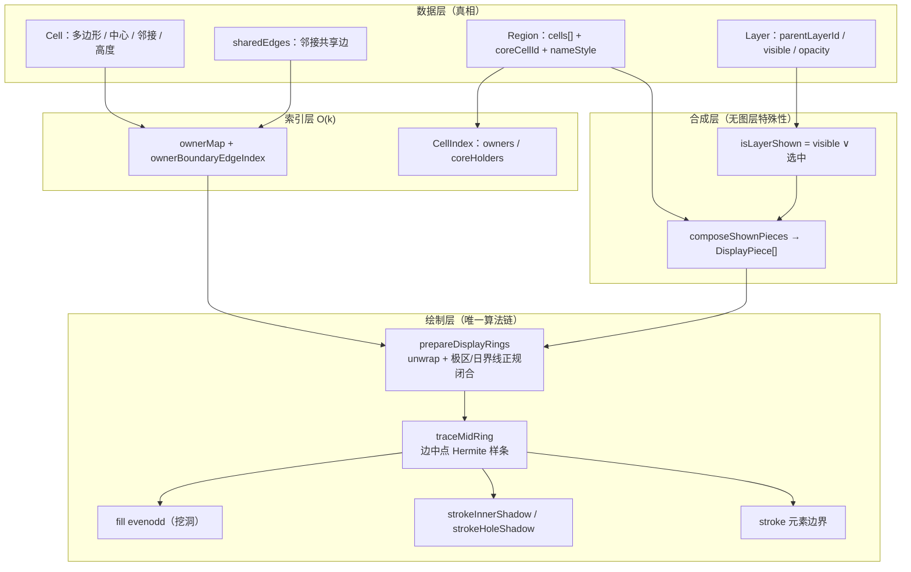
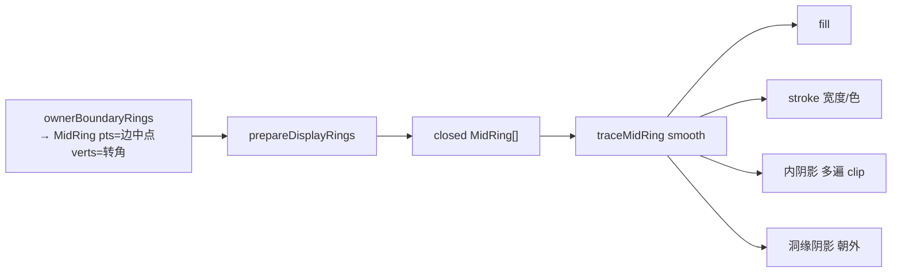
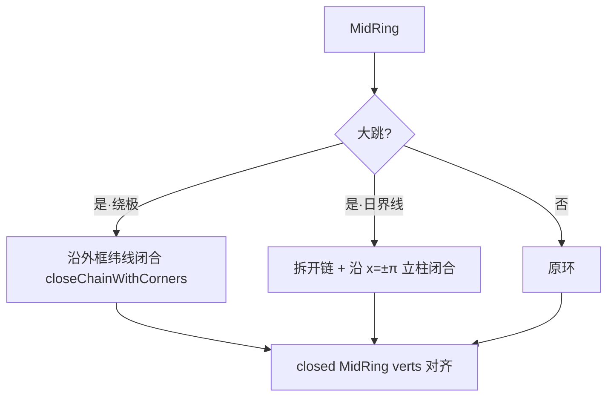
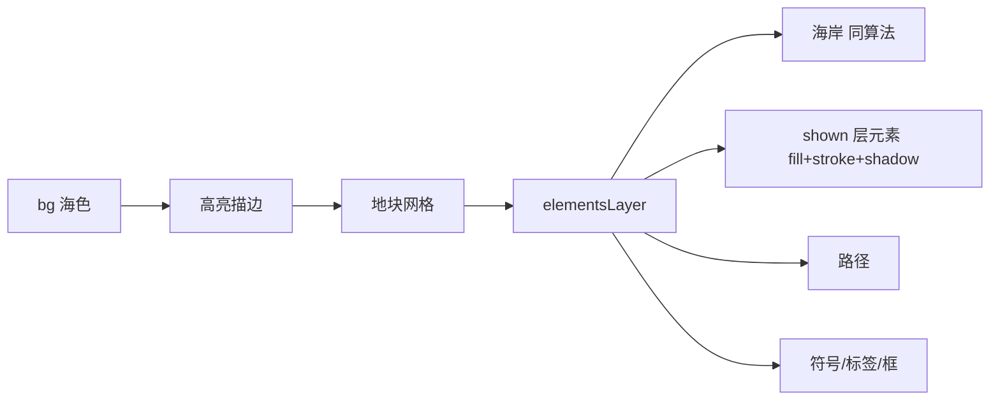
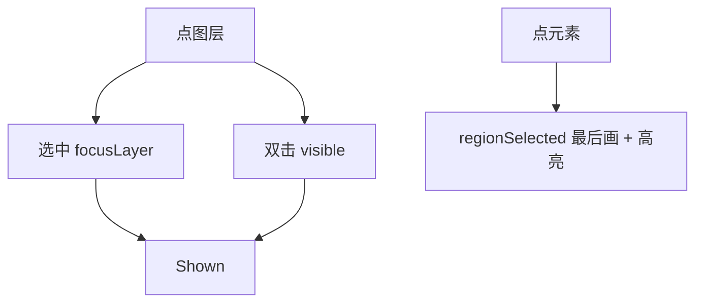

# Mapedi 显示系统架构与算法调用图

> 2026-09-23 · 与 `RENDER_LOGIC.md` 配套

## 1. 分层总览

## 2. 单元素绘制调用链（同一算法，只换参数）

**不变式**：fill / stroke / 内阴影必须共用 `prepareDisplayRings` + `traceMidRing`，禁止各自 unwrap / 各自闭合。

## 3. 极区 / 日界线

极点判定：环平均 |y| ≳ 0.55 × 外框 y(±85°)（**必须用真实投影 y**，禁止写死 ±8）。

## 4. 管线

## 5. 选中与显示

