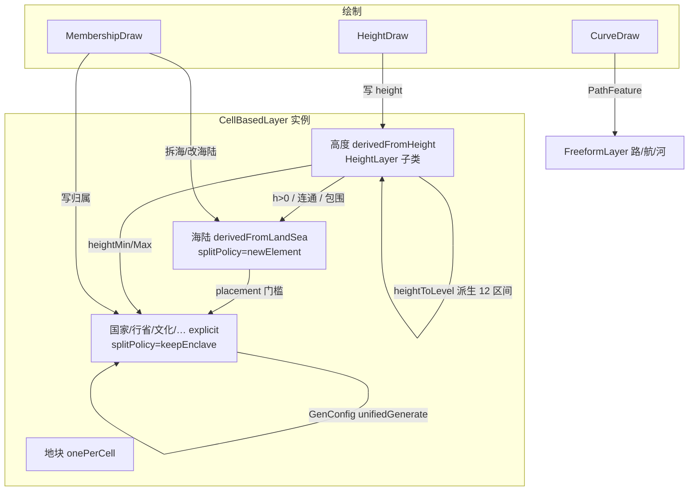

# Mapedi 图层与绘制体系方案（v0.2 重写 · 待审）

> 版：v0.2 · 日期：2026-09-24  
> 相对 v0.1 的修正：**层次是实例不是子类；特殊行为全是参数；绘制独立成类**  
> 状态：**只定方案，未实施**。请审 §12 待确认点后，再按切片实施。

---

## 0. 纠正后的总原则

1. **类很少**：`BaseLayer → CellBasedLayer / FreeformLayer`；再加绘制 `BaseDraw → HeightDraw` 等少数特化。  
2. **图层是一个个实例**（配置），不是「国家层一个子类、行省层一个子类」。  
3. **能力差异 = 参数**（是否阴影、是否列工作区、是否校验连通、仅陆/仅海…），不写特殊 if 分支。  
4. **数据真相不破**：元素仍是 `Region`（cell 归属）/ `PathFeature`（曲线）；不造第二套归属。  
5. **高度存整数**；绘制改的是 `cell.height`，区间元素归属由高度**派生**。

---

## 1. 类层次（就这些）

```text
BaseLayer
├── CellBasedLayer          // 元素占 cell；一套类，N 个配置实例
│     实例：地块 · 高度 · 海陆 · 国家 · 行省 · 文化 · 宗教 · 种族
│            · 植物 · 动物 · 环境 · 军事 …
│     （高度是否再子类：见 §3 评估 → 建议子类 HeightLayer）
│
└── FreeformLayer           // 元素不绑 cell 归属；一套类，N 个配置实例
      实例：道路 · 航线 · 河流 …
      渲染/样式独立逻辑（不走元素填充三通道）

BaseDraw
├── HeightDraw              // 特化：整数高度场 + 区间迁移
└── MembershipDraw          // 通用：cell ↔ 元素归属
      （地块、海陆拆分、国家、文化… 共用）

// 曲线不走 BaseDraw
CurveDraw                   // 控制点编辑（加点/拖端点/微调）
```

**默认不新增子类。** 只有「数据模型或交互语义根本不同」才特化（高度绘制、曲线编辑）。

---

## 2. 图层 = 一个配置实例

### 2.1 配置骨架（CellBasedLayer）

```ts
interface LayerConfig {
  id: LayerId;
  name: string;
  kind: LayerKind;              // 分类/图标/排序，不决定行为分支

  // ── 元素 ──
  elementSource: 'explicit' | 'derivedFromHeight' | 'derivedFromLandSea' | 'onePerCell';
  requireCore: boolean;         // 是否必须 coreCellId
  // ── 连通性（参数！不是 if 层名）──
  splitPolicy: 'newElement' | 'keepEnclave' | 'reject';
  //  newElement   连接断开 → 变成两个元素（大陆）
  //  keepEnclave  断开仍是一个元素（国家/行省飞地）
  //  reject       绘制/生成不允许断开
  // ── 归属限制（绘制能否落下）──
  placement: {
    landSea: 'landOnly' | 'oceanOnly' | 'any' | 'noCrossLandSea';
    heightMin?: number;         // 例：高山动物
    heightMax?: number;
  };
  // ── 生成 ──
  gen: GenConfig & {
    allowOcean: boolean;        // 海国开关（勾选则自动生成海国）
  };
  // ── 显示样式（仅元素三通道；开关即参数）──
  style: ElementStyle;
  // ── 工作区 ──
  workspace: {
    listElements: boolean;      // 地块层可 false（不列 3 万条）
    // 高度层 listElements=true，列出的就是 12 个区间
  };
}
```

### 2.2 同一类，不同参数（示例）

| 实例 | elementSource | splitPolicy | placement.landSea | style.shadow/fill | workspace.list |
|------|---------------|-------------|-------------------|-------------------|----------------|
| 地块 | `onePerCell` | — | any | **false / false** | **false** |
| 高度 | `derivedFromHeight` | （不校验） | any | true / true | true（12 区间） |
| 海陆 | `derivedFromLandSea` | **newElement** | any | true / true | true |
| 国家 | `explicit` | **keepEnclave** | landOnly※ | true / true | true |
| 行省 | `explicit` | **keepEnclave** | noCrossLandSea | true / true | true |
| 文化 | `explicit` | keepEnclave | **any**（可海上） | true / true | true |
| 动物 | `explicit` | keepEnclave | any + heightMin 可选 | true / true | true |
| 军事 | `explicit` | keepEnclave | landOnly | true / true | true |

※ 国家 `placement.landSea = 'landOnly'` 是**绘制/默认生成**约束；`gen.allowOcean = true` 时生成器可忽略 placement 产出海国（见 §7）。

**地块层「强制关阴影填充」= 默认参数 `style.shadow.enabled = false` 等，不是代码特例。** 若打开（调试）允许生效，但 UI 可标「大图层慎用」。

---

## 3. 高度层：是否独立子类？

### 3.1 高度元素 = 固定 12 个工作区间

```text
id   名称    区间         绘制赋 min
────────────────────────────────────
h0   深海   [-63,-55]  → -63
h1   远海   [-54,-40]  → -54
h2   近海   [-39,-25]  → -39
h3   浅滩   [-24,  0]  → -24
h4   海岸   [  1,  3]  →   1
h5   低地   [  4, 12]  →   4
h6   平原   [ 13, 24]  →  13
h7   高平原 [ 25, 36]  →  25
h8   丘陵   [ 37, 46]  →  37
h9   山地   [ 47, 54]  →  47
h10  高山   [ 55, 60]  →  55
h11  顶峰   [ 61, 64]  →  61
```

| 规则 | 内容 |
|------|------|
| 元素个数 | **固定 12**，不可增删 |
| 元素 cells | 该区间内全部 cell；**不校验连通**（碎块合法） |
| 归属来源 | `cell.height → heightToLevel` **派生**，不另存归属表 |
| 边界 / 平滑 | 区间与区间之间的环；`style.border.smooth` |
| 颜色卡 | **删除**；工作区 12 行即区间列表 |
| 高度存储 | **整数** −63..64（已是） |

跨区间：高度算术进出区间时，cell **自动**落到新区间元素（派生规则，无需迁移代码以外的第二套逻辑）。

### 3.2 评估结论：**高度绘制必须子类；高度图层建议子类 `HeightLayer`**

| 与通用 MembershipDraw 的差异 | 结论 |
|------------------------------|------|
| 改的是数值场 `cell.height`，不是归属表 | 需要 `HeightDraw` |
| 归属由高度派生，画完不写 `Region.cells` 手工表 | 层侧 `elementSource: derivedFromHeight` |
| 左键 +1 / 长按连加 / shift±层级 / alt=0 | 交互模型独立 |
| 元素固定 12 个，不可 count 生成 | 生成管线不同（场生成 + 归组） |

**建议：**

```text
CellBasedLayer
└── HeightLayer          // 唯一 CellBased 特化子类
      · 12 区间常量表
      · rebuildElements() = height → 12 组
      · 默认 draw = HeightDraw
```

海陆 `splitPolicy: 'newElement'` 已是参数，**不需要** LandSea 子类。  
地块 `onePerCell` 已是参数，**不需要** Cells 子类。

---

## 4. 绘制体系（重点）

### 4.1 职责划分

```text
DrawSession（会话：一次按下→抬起）
    │ 每帧/每次事件
    ▼
BaseDraw.canApply() ──读──► LayerConfig.placement / splitPolicy / overwrite
    │
    ├─ HeightDraw.apply()      → 写 cell.height（整数）→ 派生区间迁移
    └─ MembershipDraw.apply() → 写 cell ↔ element 归属

CurveDraw（独立）→ 写 PathFeature.points
```

### 4.2 接口设计

```ts
/** 正在被谁调用绘制 */
interface DrawActor {
  layerId: LayerId;
  /** 目标元素；高度层 = 区间 id（h0…h11） */
  elementId: string;
  /** 覆盖方式 */
  overwrite: 'emptyOnly' | 'replace';
  //  emptyOnly : 只画进「本层尚无元素」的 cell
  //  replace   : 可从其他元素抢走该 cell
}

/** 输入：一次指针事件的完整状态 */
interface DrawInput {
  /** 命中 */
  cellIds: CellId[];            // 笔刷覆盖的 cell（已按半径展开）
  pointer: 'left' | 'right';
  phase: 'down' | 'move' | 'up' | 'hold';
  /** 正在按下的修饰键 */
  modifiers: {
    shift: boolean;
    alt: boolean;
    ctrl: boolean;
    meta: boolean;
  };
  /** 笔刷 */
  brush: {
    radius: number;             // 世界/屏幕单位
    hardness: number;           // 0–1
    strength: number;           // 0–1，长按速率/浓度
  };
  /** 高度层长按用（HeightDraw 消费） */
  holdMs?: number;
}

/** 图层限制（写在 LayerConfig.placement，绘制前统一过闸） */
interface PlacementRule {
  landSea: 'landOnly' | 'oceanOnly' | 'any' | 'noCrossLandSea';
  heightMin?: number;
  heightMax?: number;
}

/** 预检结果 */
interface DrawGate {
  allowed: CellId[];
  blocked: Map<CellId, BlockReason>;  // 'seaOnly' | 'landOnly' | 'heightRange' | 'notEmpty' | …
}

/** 生效结果（进 undo / 脏区） */
interface DrawResult {
  heightChanges?: Map<CellId, { from: number; to: number }>;
  membershipChanges?: Array<{
    cellId: CellId;
    fromElementId: string | null;
    toElementId: string | null;
  }>;
  /** splitPolicy 引起的元素增减（海陆拆分/大陆分裂） */
  elementSplit?: Array<{ fromId: string; toIds: string[] }>;
}

/** 预览（未提交） */
interface DrawPreview {
  kind: 'height' | 'membership' | 'none';
  /** 高度：将写入的值 */
  cellHeight?: Map<CellId, number>;
  /** 归属：将写入的元素色 */
  cellTint?: Map<CellId, string>;
}

abstract class BaseDraw {
  /** 合并「命中 ∩ placement ∩ overwrite」 */
  gate(world: World, actor: DrawActor, input: DrawInput): DrawGate;
  preview(world: World, actor: DrawActor, input: DrawInput): DrawPreview;
  apply(world: World, actor: DrawActor, input: DrawInput, gate: DrawGate): DrawResult;
  /** 会话生命周期 */
  begin(world: World, actor: DrawActor, input: DrawInput): void;
  end(world: World, actor: DrawActor, input: DrawInput): DrawResult;
}
```

### 4.3 HeightDraw（子类）

| 输入 | 行为 |
|------|------|
| **左键 down/move** | 落下的 cell：`height = 区间.min`（actor.elementId 决定区间） |
| **左键 hold**（持续按压） | 对已画 cell **每个 tick +1 整数**；速率 = `brush.strength` |
| **左键 再次点击**（同 cell 已是本区间） | **+1 整数** |
| **Shift + 左键** | **升一个层级（区间）**：`height = 下一区间.min`；已是顶峰则 clamp |
| **右键 down** | **−1 整数**；已是该区间 min 且继续 −1 → 进入下一低区间（自动变元素） |
| **右键 hold** | 持续 −1 |
| **Shift + 右键** | **降一个层级**：`height = 下一低区间.min` |
| **Alt + 左键** | **height = 0**（海平面；落在浅滩/海岸交界规则：0 → 浅滩区间） |

**跨区间自动迁移：**

```text
apply 后 h' = heightToLevel(h_new)
若 h' ≠ h_old：membershipChanges 记录（区间元素派生刷新）
无需用户「改元素」操作
```

**clamp：** −63..64；出界夹紧，不抛错。

**placement：** 高度层 `landSea: 'any'`（海陆都可改高度）；高度 range 限制一般不用。

### 4.4 MembershipDraw（其余 CellBased 实例共用）

| 输入 | 行为 |
|------|------|
| **左键** | cell → `actor.elementId`（受 overwrite / placement） |
| **右键** | cell → `null`（从本元素移除；不给其他元素） |
| **Shift + 左键** | 与左键相同（保留扩展位；可用来「吸色后画」） |
| **Alt + 左键** | 吸取：把 cell 现属元素设为 `actor.elementId`（取色器） |

**overwrite：**

- `emptyOnly`：`blocked` 含 `notEmpty`（已有其他元素则拒）  
- `replace`：允许抢走，记入 `membershipChanges.fromElementId`

**splitPolicy 在 end 时处理：**

- `keepEnclave`：断开不动作（国家/行省飞地合法）  
- `newElement`：把非种子连通块拆成新元素（大陆）  
- `reject`：apply 阶段就拒掉会导致断开的 cell  

### 4.5 CurveDraw（自由层，独立逻辑）

```ts
interface CurveDraw {
  addPoint(pathId: string, lonLat: LonLat): void;
  movePoint(pathId: string, index: number, lonLat: LonLat): void;
  removePoint(pathId: string, index: number): void;
  /** 拖出多边形则清除 cell 归属（现行 endpointOverrides 语义） */
}
```

样式完全独立：`widthStart/widthEnd/color` 等，**不进**元素三通道面板。

---

## 5. 样式（仅元素三通道，全是参数）

```ts
interface ElementStyle {
  border: { enabled: boolean; width: number; color: string; smooth: number };
  shadow: { enabled: boolean; width: number; alpha: number; color: string };  // ← 开关
  fill:   { enabled: boolean; alpha: number; color: string };
}
```

| 旧字段 | 去向 |
|--------|------|
| coastBorder* | 删 → 海陆层 `border` |
| cellBorder* / cellFill* | 删 → 地块层 `border`；高度层区间 `fill` |
| innerShadow* | → `shadow.*`（+ enabled） |
| element* / fill* | → `border.*` / `fill.*` |

面板按实例的 `style.*.enabled` 显示控件；没有「该层不可用」硬编码——只读默认参数。

---

## 6. 工作区（全是参数）

| 实例 | workspace.listElements | 列表内容 | 选中含义 |
|------|------------------------|----------|----------|
| 地块 | false | — | （拾取模式） |
| 高度 | true | **12 区间** | 当前绘制目标区间 |
| 海陆 | true | 大陆/湖/海 | 当前绘制目标 / 显示 |
| 语义 | true | 元素列表 | 选中 ≡ 显示 ≡ 绘制目标 |
| 曲线 | true | 曲线列表 | 选中曲线进入 CurveDraw |

---

## 7. 生成前参数配置

### 7.1 流程

```text
[生成…] → 预设选择（可选）
        → 参数面板（可「简易」或「全部参数」）
        → 跑 unifiedGenerate / HeightLayer.generate / LandSea.rebuild
```

### 7.2 预设示例

| 预设 | 说明 |
|------|------|
| 默认大陆 | 穿极、贴一极、30k、无海国 |
| 群岛 | 多小陆、湖多 |
| 海国世界 | `country.gen.allowOcean = true` |
| 高原世界 | 高度 diffusion 峰值高、文化 core=highElevation |

### 7.3 全部参数（可折叠「高级」）

沿用 `GenConfig`（method/scope/pattern/coreSelector/count/fromLayer*）+ 本方案新增：

```ts
gen.allowOcean: boolean              // 海国
placement.landSea / heightMin / heightMax
splitPolicy
height.diffusion: { falloff, radius, roughness, peakHeight, stamps }
```

`gen.allowOcean = true` 时：生成器对国家/文化等允许 `placement` 外的海 cell（仍受高度/其它门槛约束）。默认 false。

---

## 8. 数据流（纠正后）



---

## 9. 与现有代码映射

| 现有 | 处置 |
|------|------|
| `Region` + adjacent/overlaps | 保留为元素数据 |
| `GenConfig` / `unifiedGenerate` | 保留 → 实例的 `gen` |
| `heightRegions` 12 bin | 升格为 HeightLayer 的 12 常量元素 |
| `HeightColorRuler` | 删 |
| `LayerStyle` 大杂烩 | 收敛为 `ElementStyle` |
| `PathFeature` | FreeformLayer 元素 |
| `generateDemoContinents` | HeightLayer 场生成 |
| `rebuildHeightRegions` 拆分 | 区间归组 → Height；连通块 → LandSea |
| coast / cellFill 管线 | 删，统一元素环 |

---

## 10. 模块落点

```text
core/layer/
  types.ts          LayerConfig / ElementStyle / PlacementRule / DrawActor / DrawInput …
  BaseLayer.ts      虚类：config、rebuildElements、style、workspace
  CellBasedLayer.ts 占 cell 的通用实现
  HeightLayer.ts    唯一 CellBased 子类：12 区间
  FreeformLayer.ts  曲线层
  presets.ts        预设 + defaultLayerConfigs()（每层一个配置实例）
core/draw/
  BaseDraw.ts       gate / preview / apply / begin / end
  HeightDraw.ts     ±整数 / ±层级 / alt=0
  MembershipDraw.ts 归属 + overwrite + splitPolicy
  CurveDraw.ts      控制点
core/generate/unified.ts   保留，挂在 CellBasedLayer.gen
```

---

## 11. 实施切片（每包可独立验收）

| 包 | 内容 | 验收 |
|----|------|------|
| P1 | `ElementStyle` 三通道 + shadow 开关；面板/渲染对齐 | 阴影开关即时生效；coast/cell 通道消失 |
| P2 | `LayerConfig` + 默认实例表（同类多配置） | 生成/显示读配置，无层名 if |
| P3 | `HeightLayer` + 12 区间工作区 + **HeightDraw** | 左键+1/长按连加/shift±层级/alt=0；跨区间自动换元素；删颜色卡 |
| P4 | `LandSeaLayer` 实例 + splitPolicy + 海拆分持久化 | 大陆断开=两陆；海可拆并存档 |
| P5 | `MembershipDraw` + overwrite + placement 闸 | 仅陆地层画不进海；emptyOnly 不抢 |
| P6 | `gen.allowOcean` + 生成预设/全参数面板 | 勾海国可生成；预设可选 |
| P7 | `FreeformLayer`/`CurveDraw` 分离样式 | 路/航/河不进三通道 |
| P8 | 清理死通道 / 颜色卡 / 双份生成 | build 通过 |

---

## 12. 已锁定（2026-09-24 确认）

| # | 点 | 定案 |
|---|----|------|
| 1 | 高度区间 | 固定 12 档，不校验连通 |
| 2 | 绘制赋值 | 先赋 **区间 min**；再点/长按 **+1 整数**（高度存整数） |
| 3 | 修饰键 | **左键 +1 / 右键 −1，可长按连加**；**Shift+左 = 升 1 档（12 档之一）**，**Shift+右 = 降 1 档**；**Alt+左 = height=0** |
| 4 | 跨区间 | +1/−1 **升到底/降到底即改变区间**（自动换元素）；Shift 到顶/底档则 **clamp** 在深海/顶峰 |
| 5 | 海拆分 | 持久化 |
| 6 | 连通性 | `splitPolicy`：大陆=`newElement`，国家/行省=`keepEnclave` |
| 7 | 海国 | `gen.allowOcean` 勾选才生成 |
| 8 | 生成前配置 | 预设 + 全参数面板 |
| 9 | 曲线样式 | 完全独立 |
| 10 | 类层次 | 实例+参数；仅 `HeightLayer` / `HeightDraw` / `CurveDraw` 特化 |
| 11 | 长按连加速率 | **每 100ms 一个 tick，+1（或 −1）整数 × 最多 1**（strength 控制 tick 间隔，默认 100ms） |
| 12 | Shift 跨档 | 到顶峰/深海 **clamp**；中间档直接落到目标档 **min** |

**高度键位定案（HeightDraw）：**

| 输入 | 行为 |
|------|------|
| 左键落下 | `height = 当前档.min` |
| 左键长按 | 每 100ms `+1`（越过档上界 → 进入下一档元素） |
| Shift+左键 | `height = 下一档.min`（已在顶峰 → clamp 64） |
| 右键落下 / 长按 | `−1` / 每 100ms `−1`（越过档下界 → 进入下一档） |
| Shift+右键 | `height = 下一档.min`（已在深海 → clamp −63） |
| Alt+左键 | `height = 0` |

按 P1→P8 实施。
